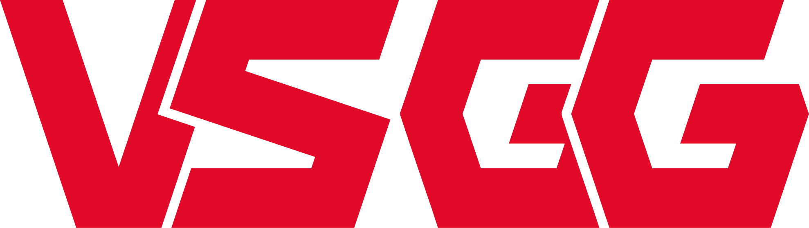

<a id="readme-top"></a>

<!-- PROJECT SHIELDS -->
<div align="center">

[![Contributors][contributors-shield]][contributors-url]
[![Forks][forks-shield]][forks-url]
[![Stargazers][stars-shield]][stars-url]
[![Issues][issues-shield]][issues-url]

<a href="README.md"></a>
<a href="README.ko.md"></a>

</div>

<!-- PROJECT LOGO -->
<br />
<div align="center">
  <a href="https://github.com/vsgg12/VSGG-FE">
    
  </a>

  <h3 align="center">VSGG — Frontend</h3>

  <p align="center">
    억울한 인게임 상황을 올리면<br />
    유저들이 과실 비율을 투표해 판결해 주는 리그 오브 레전드 커뮤니티
    <br />
    <a href="#about"><strong>문서 살펴보기 »</strong></a>
    <br />
    <br />
    <a href="https://vsgg.co.kr">웹사이트</a>
    ·
    <a href="https://github.com/vsgg12/VSGG-FE">원본 팀 레포</a>
    ·
    <a href="#performance">성능 개선</a>
  </p>
</div>

> 이 레포지토리는 팀 프로젝트 [vsgg12/VSGG-FE](https://github.com/vsgg12/VSGG-FE)를 포크한 것입니다.
> 2024년 6월부터 프론트엔드 개발자로 참여했고([담당 업무](#contributions)), 이 포크에는 `refactor/lighthouse` 브랜치의 성능 리팩토링도 포함되어 있습니다.

<!-- TABLE OF CONTENTS -->
<details>
  <summary>목차</summary>
  <ol>
    <li>
      <a href="#about">프로젝트 소개</a>
      <ul>
        <li><a href="#features">주요 기능</a></li>
        <li><a href="#built-with">기술 스택</a></li>
      </ul>
    </li>
    <li>
      <a href="#getting-started">시작하기</a>
      <ul>
        <li><a href="#prerequisites">사전 준비</a></li>
        <li><a href="#installation">설치 및 실행</a></li>
      </ul>
    </li>
    <li><a href="#structure">프로젝트 구조</a></li>
    <li><a href="#contributions">담당 업무</a></li>
    <li><a href="#performance">성능 리팩토링</a></li>
    <li><a href="#roadmap">로드맵</a></li>
    <li><a href="#contributors">기여자</a></li>
    <li><a href="#contact">연락처</a></li>
    <li><a href="#acknowledgments">참고 및 감사</a></li>
  </ol>
</details>

<!-- ABOUT THE PROJECT -->
<a id="about"></a>

## 프로젝트 소개

<!-- 스크린샷 추가: [![VSGG 스크린샷][product-screenshot]](https://vsgg.co.kr) -->

롤을 하다 보면 "이거 누구 잘못이야?"라는 논쟁이 끝나지 않습니다. **VSGG**는 그 판결을 투표로 내려 줍니다.

* 유저가 억울한 상황의 게임 영상(또는 유튜브 링크)을 올리고 관련 챔피언을 선택합니다.
* 다른 유저들이 챔피언별 **과실 비율**과 작성자의 주장에 대한 찬반을 투표합니다.
* 결과는 차트로 시각화되고, 내가 내린 판결은 판결 전적으로 쌓입니다.

<a id="features"></a>

### 주요 기능

| 기능 | 설명 |
| --- | --- |
| 소셜 로그인 | 카카오 · 네이버 · 구글 OAuth 로그인, 토큰 재발급 처리 |
| 게시글 작성 | 게임 영상 또는 유튜브 링크 업로드, 관련 챔피언 선택, 상황 설명 작성 |
| 과실 비율 투표 | 챔피언별 과실 비율 투표, 도넛 / 바 차트로 결과 시각화 |
| 주장 투표 | 작성자의 주장에 대한 찬반 투표 |
| 댓글 · 좋아요 | 댓글, 멘션이 포함된 답글, 좋아요 |
| 마이페이지 | 내 게시글, 판결 전적, 프로필 수정(닉네임 중복 확인) |
| 알림 · 검색 | 알림 목록, 게시글 검색 |
| 반응형 UI | 모바일 / 데스크탑 화면 분리, 다크모드 |

<p align="right">(<a href="#readme-top">맨 위로</a>)</p>

<a id="built-with"></a>

### 기술 스택

* [![Next][Next.js]][Next-url]
* [![React][React.js]][React-url]
* [![TypeScript][TypeScript]][TypeScript-url]
* [![TanStack Query][TanStackQuery]][TanStackQuery-url]
* [![Zustand][Zustand]][Zustand-url]
* [![Tailwind CSS][TailwindCSS]][TailwindCSS-url]
* [![React Hook Form][ReactHookForm]][ReactHookForm-url]
* [![Chart.js][ChartJS]][ChartJS-url]

그 외: Immer, Swiper, react-hot-toast, react-icons, DOMPurify, next-sitemap, ESLint, Prettier.
배포: Vercel, AWS CodeDeploy (GitHub Actions).

<p align="right">(<a href="#readme-top">맨 위로</a>)</p>

<!-- GETTING STARTED -->
<a id="getting-started"></a>

## 시작하기

<a id="prerequisites"></a>

### 사전 준비

* Node.js 18 이상
* 로컬에서 실행 중인 VSGG 백엔드

> AWS 개발 서버가 종료되어, 로컬 개발은 **로컬 Docker**로 띄운 백엔드(`http://localhost:8081`)를 사용합니다.

<a id="installation"></a>

### 설치 및 실행

1. 레포 클론
   ```sh
   git clone https://github.com/shuding0307/VSGG-FE.git
   cd VSGG-FE
   ```
2. 패키지 설치
   ```sh
   npm install
   ```
3. `.env.local`을 만들고 API 주소를 로컬 백엔드로 설정
   ```sh
   NEXT_PUBLIC_PROXY_URL=http://localhost:8081/api
   ```
4. 개발 서버 실행 후 http://localhost:3000 접속
   ```sh
   npm run dev
   ```
5. (선택) 프로덕션 빌드
   ```sh
   npm run build && npm run start
   ```

화면이 계속 로딩 중이라면 백엔드 컨테이너가 떠 있는지, `NEXT_PUBLIC_PROXY_URL`이 `3000`이 아닌 `8081` 포트를 가리키는지 확인한 뒤 `npm run dev`를 다시 실행해 주세요.

<p align="right">(<a href="#readme-top">맨 위로</a>)</p>

<!-- PROJECT STRUCTURE -->
<a id="structure"></a>

## 프로젝트 구조

```
src
├── _lib          # fetchCore(서버·클라이언트 공통 fetch) / 클라이언트 fetcher(토큰 재발급)
├── api           # 도메인별 API 함수 (post, vote, comment, login, profile, alarm ...)
├── app           # App Router 페이지 (home, post, login, signUp, myPage, search, alert, setting ...)
│   └── <page>/{desktop,mobile}   # 기기별 UI, next/dynamic으로 분리 로드
├── components    # 공통 컴포넌트 (sidebar, modals, vote, 차트, 모바일 헤더 ...)
├── hooks         # 커스텀 훅 (useIsMobile, useIsDarkMode, useChampion ...)
├── store         # Zustand 스토어
└── constants · data · types · utils
```

<p align="right">(<a href="#readme-top">맨 위로</a>)</p>

<!-- MY CONTRIBUTIONS -->
<a id="contributions"></a>

## 담당 업무

2024년 6월부터 지금까지 약 400개의 커밋을 작성했습니다. 주로 맡은 부분은 다음과 같습니다.

**투표 · 결과**
* 챔피언별 과실 비율 투표 그래프 구현 및 투표 API 연동
* Chart.js 도넛 / 바 차트로 투표 결과 시각화 (챔피언별 색상, 호버·툴팁 수정, 그래프 애니메이션)
* 투표 전에는 결과를 가리고, 작성자는 자기 게시물의 결과를 항상 볼 수 있도록 하는 노출 로직
* 새로운 투표 유형인 **주장 투표**를 데스크탑 · 모바일 · 홈 피드에 추가하고, 투표 컴포넌트를 `common/vote`로 공통화

**댓글**
* 댓글 · 답글 API 연동, 답글 작성 시 부모 댓글 작성자 닉네임 언급
* 댓글 / 답글 입력 컴포넌트 통일 (엔터 입력, 자동 포커스, 앞뒤 공백 제거)
* 댓글 작성 시 해당 댓글로, 답글 작성 시 부모 댓글로 자동 스크롤
* 댓글 삭제 및 답글이 달린 댓글 삭제 시 에러(401) 처리
* 커스텀 훅으로 "n분 전" 형식의 시간 표시, 멘션 기능, 댓글 티어 표시

**마이페이지**
* 마이페이지, 내 게시물, 판결 전적 페이지 퍼블리싱 (페이지네이션, 그래프 애니메이션)
* 커스텀 달력 컴포넌트를 이용한 판결 기간 설정 UI

**홈 · 게시글**
* 초기 API 레이어 구축 (커스텀 fetcher, 토큰 재발급), 게시글 목록 / 상세 API 연동, 네이버 로그인, not-found 페이지
* 검색, 좋아요 (좋아요 / 취소, 비로그인 시 로그인 모달), 리스트형 게시글 아이템, 최신 / 인기 토글
* 링크 복사 토스트, 게시 시간 표시, 유튜브 링크 지원, 배너 링크, 영상 클릭 이벤트 전파 수정

**모바일 · SEO**
* 홈 · 게시글 상세 모바일 버전 (헤더, 투표 영역, 댓글 영역, 푸터, 미니 사이드바)
* 메타 태그, 사이트맵

<p align="right">(<a href="#readme-top">맨 위로</a>)</p>

<!-- PERFORMANCE -->
<a id="performance"></a>

## 성능 리팩토링

브랜치: `refactor/lighthouse`

**결과**: 로컬 프로덕션 빌드(`next build && next start`) 기준, Lighthouse 모바일, 5회 측정 중앙값

| 지표 | 개선 전 | 개선 후 | 변화 |
| --- | ---: | ---: | ---: |
| Lighthouse Performance (모바일) | 82 | **97** | +15 |
| LCP | 4.14s | **2.33s** | −43.6% |
| FCP | 1.38s | **0.91s** | −34% |
| TBT | 230ms | **78ms** | −66% |
| 총 전송량 | 836KB | **557KB** | −33% |
| 홈 First Load JS | 206kB | **116kB** | −44% |

**주요 변경 사항**

1. **공통 `fetchCore` 분리**: `window` / `localStorage`에 의존하지 않는 서버·클라이언트 공통 fetch 함수를 만들고, 토큰 재발급은 클라이언트 전용 fetcher가 감싸도록 분리해 서버 컴포넌트에서도 데이터를 가져올 수 있게 했습니다.
2. **서버 prefetch + `HydrationBoundary`**: 홈 게시글 목록을 서버 컴포넌트에서 미리 가져와 TanStack Query에 hydrate하여, 클라이언트 로딩 워터폴 없이 첫 화면부터 데이터가 보이도록 했습니다.
3. **hydration-safe 렌더링**: 마운트 전까지 화면 전체를 비워두던 `isMounted` 패턴을 제거하고, 서버에서도 안전하게 렌더링되는 `useIsMobile`, `useIsDarkMode` 훅으로 대체했습니다.
4. **모바일 / 데스크탑 코드 스플리팅**: 기기별 화면을 `next/dynamic`으로 분리해 각 기기가 필요한 JS만 내려받도록 했습니다.
5. **미사용 의존성 정리**: 사용하지 않는 패키지와 타입 패키지를 제거해 번들 크기를 줄였습니다.
6. **배너 `next/image` 적용**: 배너 이미지에 반응형 사이징과 지연 로딩을 적용했고, 비디오에는 `preload` / `object-cover`를 조정했습니다.

<p align="right">(<a href="#readme-top">맨 위로</a>)</p>

<!-- ROADMAP -->
<a id="roadmap"></a>

## 로드맵

- [x] 홈 피드 서버 prefetch
- [x] 모바일 / 데스크탑 코드 스플리팅
- [x] 미사용 의존성 정리
- [ ] 게시글 썸네일 `next/image` 적용
- [ ] 유튜브 경량 임베드 (클릭 시 플레이어 로드)
- [ ] 검색 디바운스
- [ ] `moment`를 가벼운 날짜 라이브러리로 교체
- [ ] 차트 컴포넌트 지연 로딩

<p align="right">(<a href="#readme-top">맨 위로</a>)</p>

<!-- CONTRIBUTORS -->
<a id="contributors"></a>

## 기여자

VSGG는 VSGG 팀이 함께 만들었습니다. 함께한 모든 팀원에게 감사드립니다.

<table>
  <tr>
    <td align="center">
      <a href="https://github.com/shuding0307">
        <br />
        <sub><b>shuding0307</b></sub>
      </a>
    </td>
    <td align="center">
      <a href="https://github.com/jjaeho0415">
        <br />
        <sub><b>jjaeho0415</b></sub>
      </a>
    </td>
    <td align="center">
      <a href="https://github.com/jodonghyeon3">
        <br />
        <sub><b>jodonghyeon3</b></sub>
      </a>
    </td>
    <td align="center">
      <a href="https://github.com/rimtae">
        <br />
        <sub><b>rimtae</b></sub>
      </a>
    </td>
  </tr>
</table>

<p align="right">(<a href="#readme-top">맨 위로</a>)</p>

<!-- CONTACT -->
<a id="contact"></a>

## 연락처

이수현 · [@shuding0307](https://github.com/shuding0307)

프로젝트 링크: [https://github.com/shuding0307/VSGG-FE](https://github.com/shuding0307/VSGG-FE)

<p align="right">(<a href="#readme-top">맨 위로</a>)</p>

<!-- ACKNOWLEDGMENTS -->
<a id="acknowledgments"></a>

## 참고 및 감사

* [vsgg12/VSGG-FE](https://github.com/vsgg12/VSGG-FE): 원본 팀 레포지토리
* [Riot Data Dragon](https://developer.riotgames.com/docs/lol#data-dragon): 챔피언 데이터 및 이미지
* [Best-README-Template](https://github.com/othneildrew/Best-README-Template)
* [Shields.io](https://shields.io)

<p align="right">(<a href="#readme-top">맨 위로</a>)</p>

<!-- MARKDOWN LINKS & IMAGES -->
[contributors-shield]: https://img.shields.io/github/contributors/vsgg12/VSGG-FE.svg?style=for-the-badge
[contributors-url]: https://github.com/vsgg12/VSGG-FE/graphs/contributors
[forks-shield]: https://img.shields.io/github/forks/vsgg12/VSGG-FE.svg?style=for-the-badge
[forks-url]: https://github.com/vsgg12/VSGG-FE/network/members
[stars-shield]: https://img.shields.io/github/stars/vsgg12/VSGG-FE.svg?style=for-the-badge
[stars-url]: https://github.com/vsgg12/VSGG-FE/stargazers
[issues-shield]: https://img.shields.io/github/issues/vsgg12/VSGG-FE.svg?style=for-the-badge
[issues-url]: https://github.com/vsgg12/VSGG-FE/issues
[Next.js]: https://img.shields.io/badge/next.js_14-000000?style=for-the-badge&logo=nextdotjs&logoColor=white
[Next-url]: https://nextjs.org/
[React.js]: https://img.shields.io/badge/React_18-20232A?style=for-the-badge&logo=react&logoColor=61DAFB
[React-url]: https://reactjs.org/
[TypeScript]: https://img.shields.io/badge/TypeScript-3178C6?style=for-the-badge&logo=typescript&logoColor=white
[TypeScript-url]: https://www.typescriptlang.org/
[TanStackQuery]: https://img.shields.io/badge/TanStack_Query_v5-FF4154?style=for-the-badge&logo=reactquery&logoColor=white
[TanStackQuery-url]: https://tanstack.com/query
[Zustand]: https://img.shields.io/badge/Zustand-443E38?style=for-the-badge&logo=react&logoColor=white
[Zustand-url]: https://zustand-demo.pmnd.rs/
[TailwindCSS]: https://img.shields.io/badge/Tailwind_CSS-06B6D4?style=for-the-badge&logo=tailwindcss&logoColor=white
[TailwindCSS-url]: https://tailwindcss.com/
[ReactHookForm]: https://img.shields.io/badge/React_Hook_Form-EC5990?style=for-the-badge&logo=reacthookform&logoColor=white
[ReactHookForm-url]: https://react-hook-form.com/
[ChartJS]: https://img.shields.io/badge/Chart.js-FF6384?style=for-the-badge&logo=chartdotjs&logoColor=white
[ChartJS-url]: https://www.chartjs.org/
