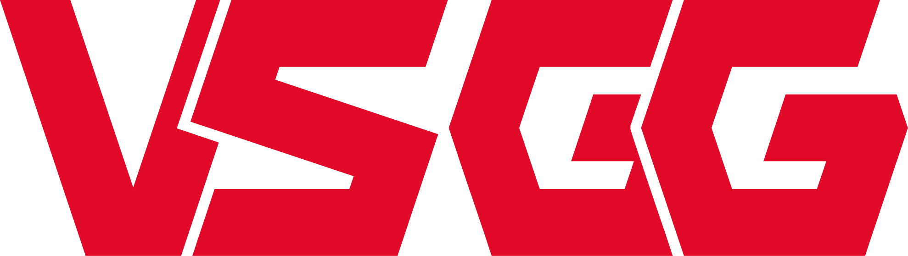

<a id="readme-top"></a>

<!-- PROJECT SHIELDS -->
<div align="center">

[![Contributors][contributors-shield]][contributors-url]
[![Forks][forks-shield]][forks-url]
[![Stargazers][stars-shield]][stars-url]
[![Issues][issues-shield]][issues-url]

<a href="#english"></a>
<a href="#korean"></a>

</div>

<!-- PROJECT LOGO -->
<br />
<div align="center">
  <a href="https://github.com/vsgg12/VSGG-FE">
    
  </a>

  <h3 align="center">VSGG — Frontend</h3>

  <p align="center">
    A League of Legends community where players share disputed in-game moments and let the community decide who was at fault.
    <br />
    리그 오브 레전드에서 억울하거나 논쟁이 되는 플레이를 공유하면, 다른 유저들이 투표로 과실 비율을 판단하는 커뮤니티
    <br />
    <a href="#about-the-project"><strong>Explore the docs »</strong></a>
    <br />
    <br />
    <a href="https://vsgg.co.kr">Website</a>
    ·
    <a href="https://github.com/vsgg12/VSGG-FE">Original Team Repo</a>
    ·
    <a href="#performance-refactoring">Performance Work</a>
  </p>
</div>

---

<a id="english"></a>

# 🇺🇸 English

> This repository is a fork of the team project [vsgg12/VSGG-FE](https://github.com/vsgg12/VSGG-FE).
> I have worked on it as a frontend developer since June 2024 ([My Contributions](#my-contributions)), and this fork also contains my performance refactoring on the `refactor/lighthouse` branch.

<!-- TABLE OF CONTENTS -->
<details>
  <summary>Table of Contents</summary>
  <ol>
    <li>
      <a href="#about-the-project">About The Project</a>
      <ul>
        <li><a href="#key-features">Key Features</a></li>
        <li><a href="#built-with">Built With</a></li>
      </ul>
    </li>
    <li>
      <a href="#getting-started">Getting Started</a>
      <ul>
        <li><a href="#prerequisites">Prerequisites</a></li>
        <li><a href="#installation">Installation</a></li>
      </ul>
    </li>
    <li><a href="#project-structure">Project Structure</a></li>
    <li><a href="#my-contributions">My Contributions</a></li>
    <li><a href="#performance-refactoring">Performance Refactoring</a></li>
    <li><a href="#roadmap">Roadmap</a></li>
    <li><a href="#contributors">Contributors</a></li>
    <li><a href="#contact">Contact</a></li>
    <li><a href="#acknowledgments">Acknowledgments</a></li>
  </ol>
</details>

<!-- ABOUT THE PROJECT -->
## About The Project

<!-- Add a screenshot here: [![VSGG Screenshot][product-screenshot]](https://vsgg.co.kr) -->

In League of Legends, disagreements over who made a mistake are part of the game. **VSGG** gives players a place to share those moments and let the community weigh in.

* Players share a disputed gameplay moment by uploading a video or adding a YouTube link, then select the champions involved.
* The community votes on each champion's **share of responsibility** and whether they agree with the author's claim.
* Voting results are visualized in charts, and each user's votes are saved in their judging history.

### Key Features

| Feature | Description |
| --- | --- |
| Social login | Kakao, Naver, and Google OAuth with token refresh |
| Post a dispute | Upload a gameplay video or YouTube link, pick the champions involved, add a description |
| Fault-ratio voting | Vote how much each champion is at fault; results shown with doughnut / bar charts |
| Claim voting | Agree or disagree with the poster's claim |
| Comments & likes | Comments, replies with mentions, likes |
| My page | My posts, judging record, profile edit (nickname duplicate check) |
| Alerts & search | Notification list and post search |
| Responsive UI | Separate mobile / desktop layouts, dark mode |

<p align="right">(<a href="#readme-top">back to top</a>)</p>

### Built With

* [![Next][Next.js]][Next-url]
* [![React][React.js]][React-url]
* [![TypeScript][TypeScript]][TypeScript-url]
* [![TanStack Query][TanStackQuery]][TanStackQuery-url]
* [![Zustand][Zustand]][Zustand-url]
* [![Tailwind CSS][TailwindCSS]][TailwindCSS-url]
* [![React Hook Form][ReactHookForm]][ReactHookForm-url]
* [![Chart.js][ChartJS]][ChartJS-url]

Also: Immer, Swiper, react-hot-toast, react-icons, DOMPurify, next-sitemap, ESLint, Prettier.
Deployed with Vercel and AWS CodeDeploy (GitHub Actions).

<p align="right">(<a href="#readme-top">back to top</a>)</p>

<!-- GETTING STARTED -->
## Getting Started

### Prerequisites

* Node.js 18+
* The VSGG backend running locally

> The AWS dev server has been shut down, so local development uses the backend running in **local Docker** on `http://localhost:8081`.

### Installation

1. Clone the repo
   ```sh
   git clone https://github.com/shuding0307/VSGG-FE.git
   cd VSGG-FE
   ```
2. Install NPM packages
   ```sh
   npm install
   ```
3. Create `.env.local` and point the API at the local backend
   ```sh
   NEXT_PUBLIC_PROXY_URL=http://localhost:8081/api
   ```
4. Run the dev server and open http://localhost:3000
   ```sh
   npm run dev
   ```
5. (Optional) Production build
   ```sh
   npm run build && npm run start
   ```

If the page keeps loading forever, check that the backend containers are up and that `NEXT_PUBLIC_PROXY_URL` points at port `8081` (not `3000`), then restart `npm run dev`.

<p align="right">(<a href="#readme-top">back to top</a>)</p>

<!-- PROJECT STRUCTURE -->
## Project Structure

```
src
├── _lib          # fetchCore (shared server/client fetch) & client fetcher (token refresh)
├── api           # API functions by domain (post, vote, comment, login, profile, alarm ...)
├── app           # App Router pages (home, post, login, signUp, myPage, search, alert, setting ...)
│   └── <page>/{desktop,mobile}   # device-specific UIs, loaded with next/dynamic
├── components    # shared components (sidebar, modals, vote, charts, mobile headers ...)
├── hooks         # custom hooks (useIsMobile, useIsDarkMode, useChampion ...)
├── store         # Zustand stores
└── constants · data · types · utils
```

<p align="right">(<a href="#readme-top">back to top</a>)</p>

<!-- MY CONTRIBUTIONS -->
## My Contributions

I have been working on this project as a frontend developer since June 2024. My main areas of contribution include:

**Voting & results**
* Implemented the champion fault-ratio voting chart and integrated it with the voting API.
* Visualized voting results with Chart.js doughnut and bar charts, including champion-specific colors, tooltips, hover interactions, and chart animations.
* Implemented result-visibility rules: voters can see the results after voting, while post authors can always view the results of their own posts.
* Added **claim voting** across desktop, mobile, and the home feed, then consolidated the related components in the shared `common/vote` directory.

**Write Post**
* Created a custom calendar component for selecting the judging period.

**Comments**
* Integrated comment and reply APIs, including nickname mentions when replying to a comment.
* Combined comment and reply inputs into a shared component with Enter-to-submit, auto-focus, and whitespace trimming.
* Added automatic scrolling to newly posted comments or their parent comments after a reply is submitted.
* Implemented comment deletion and handled API errors when deleting comments that have replies.
* Added relative timestamps (such as "n minutes ago") through a custom hook, along with mentions and tier badges.

**My page**
* Built the My Page, My Posts, and Judging History pages, including pagination and chart animations.

**Home & posts**
* Set up the initial API layer with a custom fetcher and token refresh, and integrated post-list and post-detail APIs.
* Implemented Naver login, search, likes and unlike actions, a login prompt for guest users, list-style post items, and newest/popular sorting.
* Added supporting interactions and UI details, including copy-link feedback, post timestamps, YouTube links, banner navigation, and fixes for video click-event propagation.

**Mobile & SEO**
* Developed mobile layouts for the home and post-detail pages, including the header, voting and comment sections, footer, and mini sidebar.
* Added page metadata and a sitemap to support SEO.

<p align="right">(<a href="#readme-top">back to top</a>)</p>

<!-- PERFORMANCE -->
## Performance Refactoring

Branch: `refactor/lighthouse`

**Results:** Tested with Lighthouse in mobile mode against a local production build (`next build && next start`). Each metric is the median of five runs.

| Metric | Before | After | Change |
| --- | ---: | ---: | ---: |
| Lighthouse Performance (mobile) | 82 | **97** | +15 |
| LCP | 4.14s | **2.33s** | −43.6% |
| FCP | 1.38s | **0.91s** | −34% |
| TBT | 230ms | **78ms** | −66% |
| Total transfer size | 836KB | **557KB** | −33% |
| Home First Load JS | 206kB | **116kB** | −44% |

**What I changed**

1. **Shared `fetchCore`:** Extracted a fetch utility that can run on both the server and client without depending on `window` or `localStorage`. The client-only fetcher wraps it to handle token refresh, allowing server components to fetch data as well.
2. **Server prefetching with `HydrationBoundary`:** Prefetched the home feed in a server component and hydrated the result into TanStack Query, so the initial page render can display data without waiting for a separate client-side fetch.
3. **Hydration-safe rendering:** Removed the `isMounted` pattern that kept the entire page blank until the component mounted. Replaced it with `useIsMobile` and `useIsDarkMode` hooks designed to render safely on the server.
4. **Mobile/desktop code splitting:** Split device-specific screens with `next/dynamic`, allowing each device to load the code it needs.
5. **Dependency cleanup:** Removed unused dependencies and type packages to reduce bundle size.
6. **Image and video loading improvements:** Applied responsive sizing and lazy loading to banner images with `next/image`, and adjusted video `preload` and `object-cover` settings.

<p align="right">(<a href="#readme-top">back to top</a>)</p>

<!-- ROADMAP -->
## Roadmap

- [x] Server prefetch for the home feed
- [x] Mobile / desktop code splitting
- [x] Unused dependency cleanup
- [ ] `next/image` for post thumbnails
- [ ] Lightweight YouTube embed (load the player on click)
- [ ] Debounced search
- [ ] Replace `moment` with a lighter date library
- [ ] Lazy-load chart components

<p align="right">(<a href="#readme-top">back to top</a>)</p>

<!-- CONTRIBUTORS -->
## Contributors

VSGG was built by the VSGG team. Thanks to everyone who worked on it.

<table>
  <tr>
    <td align="center">
      <a href="https://github.com/shuding0307">
        <br />
        <sub><b>shuding0307</b></sub>
      </a>
    </td>
    <td align="center">
      <a href="https://github.com/jjaeho0415">
        <br />
        <sub><b>jjaeho0415</b></sub>
      </a>
    </td>
    <td align="center">
      <a href="https://github.com/jodonghyeon3">
        <br />
        <sub><b>jodonghyeon3</b></sub>
      </a>
    </td>
    <td align="center">
      <a href="https://github.com/rimtae">
        <br />
        <sub><b>rimtae</b></sub>
      </a>
    </td>
  </tr>
</table>

<p align="right">(<a href="#readme-top">back to top</a>)</p>

<!-- CONTACT -->
## Contact

Suhyeon Lee · [@shuding0307](https://github.com/shuding0307)

Project Link: [https://github.com/shuding0307/VSGG-FE](https://github.com/shuding0307/VSGG-FE)

<p align="right">(<a href="#readme-top">back to top</a>)</p>

<!-- ACKNOWLEDGMENTS -->
## Acknowledgments

* [vsgg12/VSGG-FE](https://github.com/vsgg12/VSGG-FE), the original team repository
* [Riot Data Dragon](https://developer.riotgames.com/docs/lol#data-dragon) for champion data and images
* [Best-README-Template](https://github.com/othneildrew/Best-README-Template)
* [Shields.io](https://shields.io)

<p align="right">(<a href="#readme-top">back to top</a>)</p>

---

<a id="korean"></a>

# 🇰🇷 한국어

> 이 레포지토리는 팀 프로젝트 [vsgg12/VSGG-FE](https://github.com/vsgg12/VSGG-FE)를 포크한 것입니다.
> 2024년 6월부터 프론트엔드 개발자로 참여했고([담당 업무](#ko-contributions)), 이 포크에는 `refactor/lighthouse` 브랜치의 성능 리팩토링도 포함되어 있습니다.

<!-- TABLE OF CONTENTS -->
<details>
  <summary>목차</summary>
  <ol>
    <li>
      <a href="#ko-about">프로젝트 소개</a>
      <ul>
        <li><a href="#ko-features">주요 기능</a></li>
        <li><a href="#ko-built-with">기술 스택</a></li>
      </ul>
    </li>
    <li>
      <a href="#ko-getting-started">시작하기</a>
      <ul>
        <li><a href="#ko-prerequisites">사전 준비</a></li>
        <li><a href="#ko-installation">설치 및 실행</a></li>
      </ul>
    </li>
    <li><a href="#ko-structure">프로젝트 구조</a></li>
    <li><a href="#ko-contributions">담당 업무</a></li>
    <li><a href="#ko-performance">성능 리팩토링</a></li>
    <li><a href="#ko-roadmap">로드맵</a></li>
    <li><a href="#ko-contributors">기여자</a></li>
    <li><a href="#ko-contact">연락처</a></li>
    <li><a href="#ko-acknowledgments">참고 및 감사</a></li>
  </ol>
</details>

<!-- ABOUT THE PROJECT -->
<a id="ko-about"></a>

## 프로젝트 소개

<!-- 스크린샷 추가: [![VSGG 스크린샷][product-screenshot]](https://vsgg.co.kr) -->

리그 오브 레전드를 하다 보면 플레이 중 누구의 잘못인지 의견이 갈리는 순간이 있습니다. **VSGG**는 이런 상황을 공유하고, 커뮤니티 투표를 통해 다양한 유저의 판단을 확인할 수 있는 서비스입니다.

* 유저는 논쟁이 되는 게임 장면을 영상으로 업로드하거나 유튜브 링크로 공유하고, 관련 챔피언을 선택합니다.
* 다른 유저들은 챔피언별 **과실 비율**과 게시글 작성자의 주장에 대한 찬반을 투표합니다.
* 투표 결과는 차트로 시각화되며, 유저가 참여한 투표는 판결 전적에 기록됩니다.

<a id="ko-features"></a>

### 주요 기능

| 기능 | 설명 |
| --- | --- |
| 소셜 로그인 | 카카오 · 네이버 · 구글 OAuth 로그인, 토큰 재발급 처리 |
| 게시글 작성 | 게임 영상 또는 유튜브 링크 업로드, 관련 챔피언 선택, 상황 설명 작성 |
| 과실 비율 투표 | 챔피언별 과실 비율 투표, 도넛 / 바 차트로 결과 시각화 |
| 주장 투표 | 작성자의 주장에 대한 찬반 투표 |
| 댓글 · 좋아요 | 댓글, 멘션이 포함된 답글, 좋아요 |
| 마이페이지 | 내 게시글, 판결 전적, 프로필 수정(닉네임 중복 확인) |
| 알림 · 검색 | 알림 목록, 게시글 검색 |
| 반응형 UI | 모바일 / 데스크탑 화면 분리, 다크모드 |

<p align="right">(<a href="#readme-top">맨 위로</a>)</p>

<a id="ko-built-with"></a>

### 기술 스택

* [![Next][Next.js]][Next-url]
* [![React][React.js]][React-url]
* [![TypeScript][TypeScript]][TypeScript-url]
* [![TanStack Query][TanStackQuery]][TanStackQuery-url]
* [![Zustand][Zustand]][Zustand-url]
* [![Tailwind CSS][TailwindCSS]][TailwindCSS-url]
* [![React Hook Form][ReactHookForm]][ReactHookForm-url]
* [![Chart.js][ChartJS]][ChartJS-url]

그 외: Immer, Swiper, react-hot-toast, react-icons, DOMPurify, next-sitemap, ESLint, Prettier.
배포: Vercel, AWS CodeDeploy (GitHub Actions).

<p align="right">(<a href="#readme-top">맨 위로</a>)</p>

<!-- GETTING STARTED -->
<a id="ko-getting-started"></a>

## 시작하기

<a id="ko-prerequisites"></a>

### 사전 준비

* Node.js 18 이상
* 로컬에서 실행 중인 VSGG 백엔드

> AWS 개발 서버가 종료되어, 로컬 개발은 **로컬 Docker**로 띄운 백엔드(`http://localhost:8081`)를 사용합니다.

<a id="ko-installation"></a>

### 설치 및 실행

1. 레포 클론
   ```sh
   git clone https://github.com/shuding0307/VSGG-FE.git
   cd VSGG-FE
   ```
2. 패키지 설치
   ```sh
   npm install
   ```
3. `.env.local`을 만들고 API 주소를 로컬 백엔드로 설정
   ```sh
   NEXT_PUBLIC_PROXY_URL=http://localhost:8081/api
   ```
4. 개발 서버 실행 후 http://localhost:3000 접속
   ```sh
   npm run dev
   ```
5. (선택) 프로덕션 빌드
   ```sh
   npm run build && npm run start
   ```

화면이 계속 로딩 중이라면 백엔드 컨테이너가 떠 있는지, `NEXT_PUBLIC_PROXY_URL`이 `3000`이 아닌 `8081` 포트를 가리키는지 확인한 뒤 `npm run dev`를 다시 실행해 주세요.

<p align="right">(<a href="#readme-top">맨 위로</a>)</p>

<!-- PROJECT STRUCTURE -->
<a id="ko-structure"></a>

## 프로젝트 구조

```
src
├── _lib          # fetchCore(서버·클라이언트 공통 fetch) / 클라이언트 fetcher(토큰 재발급)
├── api           # 도메인별 API 함수 (post, vote, comment, login, profile, alarm ...)
├── app           # App Router 페이지 (home, post, login, signUp, myPage, search, alert, setting ...)
│   └── <page>/{desktop,mobile}   # 기기별 UI, next/dynamic으로 분리 로드
├── components    # 공통 컴포넌트 (sidebar, modals, vote, 차트, 모바일 헤더 ...)
├── hooks         # 커스텀 훅 (useIsMobile, useIsDarkMode, useChampion ...)
├── store         # Zustand 스토어
└── constants · data · types · utils
```

<p align="right">(<a href="#readme-top">맨 위로</a>)</p>

<!-- MY CONTRIBUTIONS -->
<a id="ko-contributions"></a>

## 담당 업무

2024년 6월부터 프론트엔드 개발자로 프로젝트에 참여해 약 400개의 커밋을 작성했습니다. 주요 담당 업무는 다음과 같습니다.

**투표 · 결과**
* 챔피언별 과실 비율 투표 그래프를 구현하고 투표 API를 연동했습니다.
* Chart.js의 도넛 및 바 차트로 투표 결과를 시각화하고, 챔피언별 색상과 툴팁, 호버 인터랙션, 그래프 애니메이션을 구현했습니다.
* 투표에 참여한 뒤 결과를 확인할 수 있도록 노출 로직을 구현했으며, 게시글 작성자는 본인 게시글의 결과를 항상 확인할 수 있도록 처리했습니다.
* 새로운 투표 유형인 **주장 투표**를 데스크탑, 모바일, 홈 피드에 적용하고 관련 컴포넌트를 `common/vote` 폴더로 통합했습니다.

**댓글**
* 댓글과 답글 API를 연동하고, 답글 작성 시 부모 댓글 작성자의 닉네임이 언급되도록 구현했습니다.
* Enter 키로 등록하고 자동 포커스를 지원하며 입력값의 앞뒤 공백을 제거하는 댓글·답글 공통 입력 컴포넌트를 만들었습니다.
* 댓글 등록 후에는 새 댓글로, 답글 등록 후에는 부모 댓글 위치로 자동 스크롤되도록 구현했습니다.
* 댓글 삭제 기능과 답글이 달린 댓글 삭제 시 발생하는 API 오류 처리를 구현했습니다.
* 커스텀 훅을 활용해 'n분 전' 형식의 시간을 표시하고, 멘션 및 댓글 티어 UI를 추가했습니다.

**마이페이지**
* 마이페이지, 내 게시물, 판결 전적 페이지를 구현하고 페이지네이션과 그래프 애니메이션을 적용했습니다.
* 커스텀 달력 컴포넌트를 활용해 판결 기간을 설정하는 UI를 구현했습니다.

**홈 · 게시글**
* 커스텀 fetcher와 토큰 재발급 로직을 포함한 초기 API 레이어를 구축하고, 게시글 목록·상세 API를 연동했습니다.
* 네이버 로그인, 게시글 검색, 좋아요 및 취소, 비로그인 사용자를 위한 로그인 모달, 리스트형 게시글 UI, 최신순·인기순 정렬 기능을 구현했습니다.
* 링크 복사 안내, 게시 시간 표시, 유튜브 링크 지원, 배너 이동 기능을 추가하고 영상 클릭 이벤트 전파 문제를 수정했습니다.

**모바일 · SEO**
* 헤더, 투표 영역, 댓글 영역, 푸터, 미니 사이드바 등을 포함해 홈과 게시글 상세 페이지의 모바일 UI를 구현했습니다.
* SEO를 위한 메타 태그와 사이트맵을 추가했습니다.

<p align="right">(<a href="#readme-top">맨 위로</a>)</p>

<!-- PERFORMANCE -->
<a id="ko-performance"></a>

## 성능 리팩토링

브랜치: `refactor/lighthouse`

**측정 기준:** 로컬 프로덕션 빌드(`next build && next start`)에서 Lighthouse 모바일 모드로 5회 측정했으며, 각 지표는 측정값의 중앙값입니다.

| 지표 | 개선 전 | 개선 후 | 변화 |
| --- | ---: | ---: | ---: |
| Lighthouse Performance (모바일) | 82 | **97** | +15 |
| LCP | 4.14s | **2.33s** | −43.6% |
| FCP | 1.38s | **0.91s** | −34% |
| TBT | 230ms | **78ms** | −66% |
| 총 전송량 | 836KB | **557KB** | −33% |
| 홈 First Load JS | 206kB | **116kB** | −44% |

**주요 변경 사항**

1. **공통 `fetchCore` 분리:** `window`나 `localStorage`에 의존하지 않는 서버·클라이언트 공통 fetch 함수를 분리했습니다. 토큰 재발급은 클라이언트 전용 fetcher에서 처리하도록 구성해 서버 컴포넌트에서도 데이터 요청이 가능하도록 개선했습니다.
2. **서버 prefetch와 `HydrationBoundary` 적용:** 홈 게시글 목록을 서버 컴포넌트에서 미리 가져온 뒤 TanStack Query 캐시에 전달했습니다. 이를 통해 클라이언트에서 데이터를 다시 불러오는 과정을 기다리지 않고 초기 화면에 게시글을 표시할 수 있도록 했습니다.
3. **Hydration을 고려한 렌더링 개선:** 컴포넌트가 마운트될 때까지 페이지 전체를 비워두던 `isMounted` 패턴을 제거했습니다. 대신 서버와 클라이언트의 초기 렌더링 차이를 고려한 `useIsMobile`, `useIsDarkMode` 훅을 적용했습니다.
4. **모바일·데스크탑 코드 스플리팅:** 기기별 화면을 `next/dynamic`으로 분리해 각 환경에서 필요한 JavaScript만 로드하도록 구성했습니다.
5. **불필요한 의존성 제거:** 사용하지 않는 패키지와 타입 패키지를 정리해 번들 크기를 줄였습니다.
6. **이미지·비디오 로딩 최적화:** 배너 이미지에 `next/image`의 반응형 사이징과 지연 로딩을 적용하고, 비디오의 `preload` 및 `object-cover` 설정을 조정했습니다.

<p align="right">(<a href="#readme-top">맨 위로</a>)</p>

<!-- ROADMAP -->
<a id="ko-roadmap"></a>

## 로드맵

- [x] 홈 피드 서버 prefetch
- [x] 모바일 / 데스크탑 코드 스플리팅
- [x] 미사용 의존성 정리
- [ ] 게시글 썸네일 `next/image` 적용
- [ ] 유튜브 경량 임베드 (클릭 시 플레이어 로드)
- [ ] 검색 디바운스
- [ ] `moment`를 가벼운 날짜 라이브러리로 교체
- [ ] 차트 컴포넌트 지연 로딩

<p align="right">(<a href="#readme-top">맨 위로</a>)</p>

<!-- CONTRIBUTORS -->
<a id="ko-contributors"></a>

## 기여자

VSGG는 VSGG 팀이 함께 만들었습니다. 함께한 모든 팀원에게 감사드립니다.

<table>
  <tr>
    <td align="center">
      <a href="https://github.com/shuding0307">
        <br />
        <sub><b>shuding0307</b></sub>
      </a>
    </td>
    <td align="center">
      <a href="https://github.com/jjaeho0415">
        <br />
        <sub><b>jjaeho0415</b></sub>
      </a>
    </td>
    <td align="center">
      <a href="https://github.com/jodonghyeon3">
        <br />
        <sub><b>jodonghyeon3</b></sub>
      </a>
    </td>
    <td align="center">
      <a href="https://github.com/rimtae">
        <br />
        <sub><b>rimtae</b></sub>
      </a>
    </td>
  </tr>
</table>

<p align="right">(<a href="#readme-top">맨 위로</a>)</p>

<!-- CONTACT -->
<a id="ko-contact"></a>

## 연락처

이수현 · [@shuding0307](https://github.com/shuding0307)

프로젝트 링크: [https://github.com/shuding0307/VSGG-FE](https://github.com/shuding0307/VSGG-FE)

<p align="right">(<a href="#readme-top">맨 위로</a>)</p>

<!-- ACKNOWLEDGMENTS -->
<a id="ko-acknowledgments"></a>

## 참고 및 감사

* [vsgg12/VSGG-FE](https://github.com/vsgg12/VSGG-FE): 원본 팀 레포지토리
* [Riot Data Dragon](https://developer.riotgames.com/docs/lol#data-dragon): 챔피언 데이터 및 이미지
* [Best-README-Template](https://github.com/othneildrew/Best-README-Template)
* [Shields.io](https://shields.io)

<p align="right">(<a href="#readme-top">맨 위로</a>)</p>

<!-- MARKDOWN LINKS & IMAGES -->
[contributors-shield]: https://img.shields.io/github/contributors/vsgg12/VSGG-FE.svg?style=for-the-badge
[contributors-url]: https://github.com/vsgg12/VSGG-FE/graphs/contributors
[forks-shield]: https://img.shields.io/github/forks/vsgg12/VSGG-FE.svg?style=for-the-badge
[forks-url]: https://github.com/vsgg12/VSGG-FE/network/members
[stars-shield]: https://img.shields.io/github/stars/vsgg12/VSGG-FE.svg?style=for-the-badge
[stars-url]: https://github.com/vsgg12/VSGG-FE/stargazers
[issues-shield]: https://img.shields.io/github/issues/vsgg12/VSGG-FE.svg?style=for-the-badge
[issues-url]: https://github.com/vsgg12/VSGG-FE/issues
[Next.js]: https://img.shields.io/badge/next.js_14-000000?style=for-the-badge&logo=nextdotjs&logoColor=white
[Next-url]: https://nextjs.org/
[React.js]: https://img.shields.io/badge/React_18-20232A?style=for-the-badge&logo=react&logoColor=61DAFB
[React-url]: https://reactjs.org/
[TypeScript]: https://img.shields.io/badge/TypeScript-3178C6?style=for-the-badge&logo=typescript&logoColor=white
[TypeScript-url]: https://www.typescriptlang.org/
[TanStackQuery]: https://img.shields.io/badge/TanStack_Query_v5-FF4154?style=for-the-badge&logo=reactquery&logoColor=white
[TanStackQuery-url]: https://tanstack.com/query
[Zustand]: https://img.shields.io/badge/Zustand-443E38?style=for-the-badge&logo=react&logoColor=white
[Zustand-url]: https://zustand-demo.pmnd.rs/
[TailwindCSS]: https://img.shields.io/badge/Tailwind_CSS-06B6D4?style=for-the-badge&logo=tailwindcss&logoColor=white
[TailwindCSS-url]: https://tailwindcss.com/
[ReactHookForm]: https://img.shields.io/badge/React_Hook_Form-EC5990?style=for-the-badge&logo=reacthookform&logoColor=white
[ReactHookForm-url]: https://react-hook-form.com/
[ChartJS]: https://img.shields.io/badge/Chart.js-FF6384?style=for-the-badge&logo=chartdotjs&logoColor=white
[ChartJS-url]: https://www.chartjs.org/
